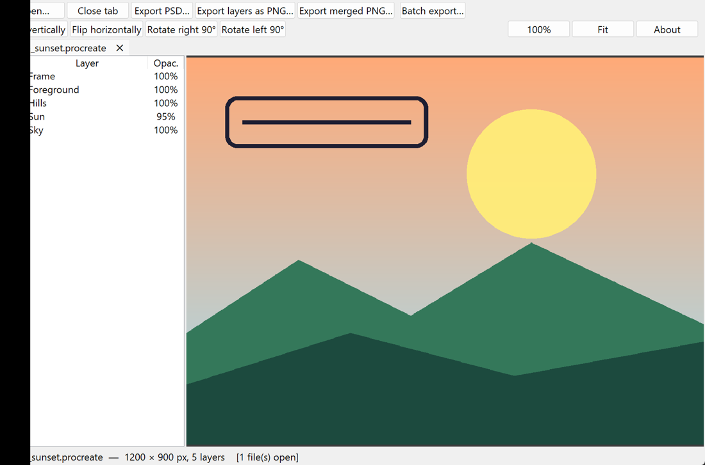
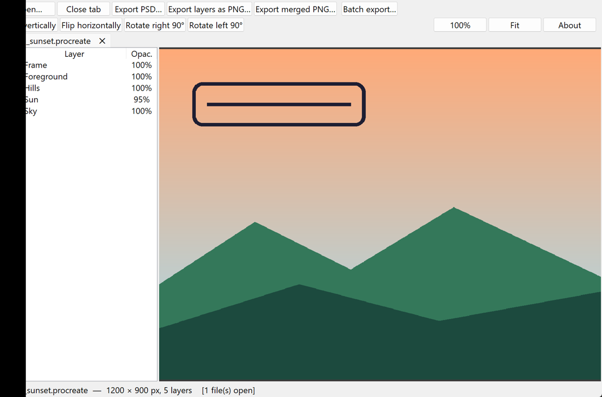

<p align="center"></p>

**LayerPeek is a .procreate file reader for Windows.**

Open Procreate artwork on a PC without an iPad or a Mac: look at the image, switch individual
layers on and off, and export everything as a layered **PSD** or as transparent **PNG**s.



## Features

- **Drag and drop** `.procreate` files from Explorer onto the window, or use *Open* / `Ctrl+O`
- **Multiple files at once**, each in its own tab (close with the ✕, middle-click or `Ctrl+W`)
- **Layer panel**: show/hide any layer, the preview updates instantly
- **Zoom and pan** with the mouse wheel and drag, *Fit* and *100%* buttons
- **Flip** vertically / horizontally and **rotate** 90° left or right
- **Export**
  - **PSD**: all layers kept separate, with names, opacity and visibility
  - **PNG per layer**: transparent, numbered from the bottom layer up
  - **Merged PNG**: all visible layers combined
  - **Batch export**: every open file at once, as PSD, PNG or both
- Sharp on high-DPI screens
- Your original files are never modified



## Download

Get `LayerPeek.exe` from the [Releases](../../releases) page. It is a single file and needs no
installation or Python.

> Windows SmartScreen or your antivirus may warn about an "unknown publisher". The executable is
> built with PyInstaller and is not code-signed. You can read the full source in this repository
> and build it yourself (see below).

## Quick start

1. Start `LayerPeek.exe`.
2. Drag one or more `.procreate` files into the window.
3. Click the checkboxes in the layer list to hide or show layers.
4. Use the toolbar to flip or rotate, then export with **Export PSD…**, **Export layers as PNG…**,
   **Export merged PNG…** or **Batch export…**.

If an image comes out upside down, press **Flip vertically**. Press `F1` or **About** for the
built-in help.

Keyboard: `Ctrl+O` open · `Ctrl+W` close tab · `Ctrl+Tab` next tab · `F1` help.

## Run or build from source

Requires Python 3.9+ on Windows.

```bash
pip install -r requirements.txt
python src/layerpeek.py my_art.procreate
```

Build the single-file executable:

```bash
build.bat
```

The result is `dist\LayerPeek.exe`.

A small command-line version of the reader is included too. It dumps the thumbnail, a merged
image and every layer as PNG:

```bash
python src/procreate_reader.py my_art.procreate
```

## How it works

A `.procreate` file is a ZIP archive:

| Part | What it contains |
| --- | --- |
| `Document.archive` | Binary plist (NSKeyedArchiver): canvas size, tile size, layer names, opacity, visibility |
| `<layer-uuid>/<col>~<row>.chunk` | The pixels of one layer, in tiles (usually 256 × 256), LZO-compressed RGBA |
| `QuickLook/Thumbnail.png` | The preview image |

Things LayerPeek has to handle, in case you want to write your own reader:

- Tiles are LZO1X compressed. LayerPeek ships a small pure-Python decompressor.
- Rows are stored **bottom-up**, so the image has to be flipped vertically.
- Pixels are **premultiplied** alpha and are converted back to straight alpha for export.
- The layer list is stored **top layer first**.
- The plist contains reference cycles, so it has to be resolved with a depth limit.

## Limitations

- **Blend modes are not applied.** Multiply, Overlay and the others are treated as Normal, so the
  merged image can differ from Procreate. Individual layers are exported exactly.
- Brushes, text layers, animation and time-lapse video are not read.
- Layer groups and clipping masks are not interpreted.
- Tested on a limited number of files. If a file does not open, please open an issue and, if you
  can, attach a small example file.

## Disclaimer

LayerPeek is an independent, unofficial project. It is **not affiliated with, endorsed by, or
sponsored by Savage Interactive**, the makers of Procreate. "Procreate" is a trademark of its
owner. The `.procreate` file format is not publicly documented; this tool was written from
observation of the files, without using any Procreate code.

## Third-party software

| Component | License |
| --- | --- |
| [Pillow](https://python-pillow.org/) | HPND |
| [NumPy](https://numpy.org/) | BSD-3-Clause |
| [tkinterdnd2](https://github.com/Eliav2/tkinterdnd2) | MIT |
| [PyInstaller](https://pyinstaller.org/) (build only) | GPL-2.0 with a bootloader exception that permits distributing the built executable under any license |
| [Python](https://www.python.org/) | PSF License |

## License

[MIT](LICENSE)
